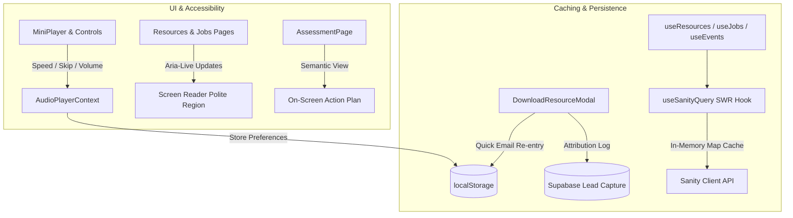

# Requirements

### Overview & Goals
Based on the comprehensive architectural and UI/UX evaluation of the Unlock Her Tech platform, this plan prioritizes high-impact improvements across user experience, accessibility, performance, and data architecture (excluding 2A interactive track progress).

The overarching objective is to maximize positive user outcomes — reducing friction for learners and podcast listeners, elevating accessibility for assistive technologies, accelerating page responsiveness, and establishing clean data fetching patterns across the codebase.

---

### Prioritized Scope & Objectives

#### Priority 1: High-Utility Audio Player Controls & Member Unlock Persistence
- **Playback Controls & Persistence:**
  - Add playback rate controls (`0.75x`, `1x`, `1.25x`, `1.5x`, `1.75x`, `2x`) and 15-second skip backward / forward buttons in `MiniPlayer.tsx`.
  - Persist playback rate and volume settings in `localStorage` (`uht_audio_playback_rate`, `uht_audio_volume`) within `AudioPlayerContext.tsx`.
- **Existing Member Direct Unlock:**
  - Add a lightweight "Already unlocked? Quick email entry" mode in `DownloadResourceModal.tsx` so returning visitors or multi-device users bypass full form fields while ensuring proper Supabase lead attribution.

#### Priority 2: Accessible Live Filter Announcements (`aria-live`)
- **Assistive Navigation Feedback:**
  - Add accessible `aria-live="polite"` dynamic announcement regions in `ResourcesPage.tsx` and `JobsPage.tsx`.
  - Announce real-time result counts and active filter states (e.g. *"Showing 6 technical playbooks matching System Design"*) to screen readers on search or category changes.

#### Priority 3: Assessment Semantic On-Screen Action Plan
- **Accessible & Mobile-First Assessment Dashboard:**
  - Enhance `AssessmentPage.tsx` to render an accessible on-screen breakdown of category scores, career readiness stage, and top 3 prioritized action items directly above the PDF download trigger.
  - Ensures mobile users and visitors using assistive technologies receive immediate value without requiring external PDF viewer switching.

#### Priority 4: Standardized In-Memory SWR Caching Layer (`useSanityQuery`)
- **Deduplicated Data Fetching:**
  - Introduce a reusable `useSanityQuery<T>` hook with in-memory caching and configurable TTL (default 5 minutes).
  - Adopt across `useResources.ts`, `useJobs.ts`, and `useEvents.ts` to prevent redundant network fetches, eliminate layout shift during rapid route switching, and provide unified loading/error states.

#### Out of Scope
- Interactive learning progress tracking in She Leads Tech (explicitly excluded).
- Breaking existing Sanity schemas or modifying Netlify serverless routing contracts.

---

### User Stories
- **As a podcast listener**, I want to adjust playback speed (`1.25x`, `1.5x`, etc.) and skip backwards/forwards 15 seconds so that I can consume audio content at my preferred pace.
- **As a returning community member**, I want to quickly re-enter my email without re-filling every form field so that I can unlock new guides immediately on any device.
- **As a screen reader user**, I want search and category filter count changes announced aloud so that I understand how many matching guides or job listings are available.
- **As a career assessment taker on mobile**, I want to see my customized scores and key focus recommendations directly on the screen so that I do not have to switch apps or download files to view my results.

---

### Non-Functional Requirements
- **Accessibility:** WCAG 2.1 AA compliance with explicit ARIA labels, polite live regions, and keyboard-focusable audio controls.
- **Performance:** Zero layout shifts (CLS < 0.01) during data refetching; cached Sanity responses resolve synchronously in under 5ms.
- **Code Quality:** Adhere strictly to `.agents/skills/frontend-code-quality/SKILL.md` (explicit button types, readonly props, no nested ternaries, native dialogs).

# Technical Design

### Current Implementation
- **Audio Playback:** Managed by `AudioPlayerContext.tsx` and `AudioPlayerCtx.ts` with controls in `MiniPlayer.tsx`. Supports play/pause, seek slider, and close button, but lacks speed controls, skip buttons, or persistent preferences.
- **Lead Capture Modal:** `DownloadResourceModal.tsx` stores email in `localStorage` but requires filling out the full multi-input form if the local storage is cleared or on a new device.
- **Filter Announcements:** `ResourcesPage.tsx` and `JobsPage.tsx` update DOM elements dynamically without `aria-live` containers.
- **Assessment Results:** `AssessmentPage.tsx` renders stage summaries and immediately prompts for a 2-page PDF download via `jspdf`, lacking a comprehensive interactive on-screen action breakdown.
- **Data Fetching Hooks:** `useResources.ts`, `useJobs.ts`, and `useEvents.ts` independently fetch from Sanity without client-side caching.

---

### Key Decisions
1. **Audio Player Context Extensions:** Extend `AudioPlayerState` with `playbackRate: number`, `setPlaybackRate: (rate: number) => void`, `skip: (seconds: number) => void`, and `volume: number`. Persist values to `localStorage` on change and restore on audio mount.
2. **Accessible Live Region Strategy:** Utilize visually hidden `aria-live="polite"` elements with debounced text updates to prevent screen reader stuttering while typing in search inputs.
3. **Responsive Assessment Summary Component:** Decompose assessment results into a clean, semantic `AssessmentScoreCard` and `AssessmentActionSteps` component rendered directly on `/assessment`.
4. **Lightweight Stale-While-Revalidate Caching Hook:** Implement `useSanityQuery<T>` utilizing a module-scoped in-memory cache map with timestamp-based TTL invalidation.

---

### Data Models & Component Contracts

#### 1. Audio Player State Interface (`src/app/context/AudioPlayerCtx.ts`)
```ts
export interface AudioPlayerState {
  currentEpisode: Episode | null;
  isPlaying: boolean;
  currentTime: number;
  duration: number;
  playbackRate: number;
  volume: number;
  hasError: boolean;
  toggle: (episode: Episode) => void;
  seek: (seconds: number) => void;
  skip: (seconds: number) => void;
  setPlaybackRate: (rate: number) => void;
  setVolume: (volume: number) => void;
  dismiss: () => void;
  isActive: (id: number) => boolean;
  isThisPlaying: (id: number) => boolean;
}
```

#### 2. Generic Sanity Query Hook Contract (`src/app/hooks/useSanityQuery.ts`)
```ts
export interface QueryResult<T> {
  data: T | null;
  loading: boolean;
  error: string | null;
  refetch: () => Promise<void>;
}

export function useSanityQuery<T>(
  queryKey: string,
  fetcher: () => Promise<T>,
  options?: { ttlMs?: number; enabled?: boolean }
): QueryResult<T>;
```

---

### File Structure
```text
src/
├── app/
│   ├── context/
│   │   ├── AudioPlayerContext.tsx        # [MODIFIED] Add speed, skip, volume & localStorage sync
│   │   └── AudioPlayerCtx.ts             # [MODIFIED] Extended AudioPlayerState contract
│   ├── hooks/
│   │   ├── useSanityQuery.ts             # [NEW] Reusable in-memory SWR caching hook
│   │   └── useAudioPlayer.ts             # [UNTOUCHED] Consumer hook
│   ├── components/
│   │   ├── MiniPlayer.tsx                # [MODIFIED] Add speed dropdown & 15s skip buttons
│   │   ├── DownloadResourceModal.tsx     # [MODIFIED] Add fast-path returning member toggle
│   │   └── assessments/
│   │       └── AssessmentOnScreenPlan.tsx # [NEW] Semantic interactive action plan dashboard
│   ├── pages/
│   │   ├── AssessmentPage.tsx            # [MODIFIED] Integrate on-screen action plan display
│   │   ├── ResourcesPage.tsx             # [MODIFIED] Add aria-live count announcements & useSanityQuery
│   │   ├── JobsPage.tsx                  # [MODIFIED] Add aria-live count announcements & useSanityQuery
│   │   ├── resources/
│   │   │   └── useResources.ts           # [MODIFIED] Integrate useSanityQuery caching
│   │   ├── jobs/
│   │   │   └── useJobs.ts                # [MODIFIED] Integrate useSanityQuery caching
│   │   └── events/
│   │       └── useEvents.ts              # [MODIFIED] Integrate useSanityQuery caching
└── test/
    ├── AudioPlayerControls.test.tsx      # [NEW] Test skip, playback rates, and volume
    ├── DownloadResourceModal.test.tsx    # [MODIFIED] Test returning member fast path
    ├── AssessmentPage.test.tsx           # [MODIFIED] Test on-screen summary rendering
    └── useSanityQuery.test.ts            # [NEW] Test in-memory cache TTL and refetching
```

---

### Architecture Diagram


---

### Risks & Mitigations
- **Audio Playback Speed Support on Mobile Browsers:** Standard HTMLAudioElement `playbackRate` is supported across modern browsers (Safari iOS, Chrome Android). We ensure fallback to `1.0` if unsupported.
- **Cache Invalidation:** SWR cache TTL is defaulted to 5 minutes with automatic background revalidation so fresh content published in Sanity Studio reflects quickly.

# Testing

### Validation Approach
Automated validation through Vitest unit and component tests, verifying audio playback controls, modal fast-paths, on-screen assessment summaries, and cached query hooks.

---

### Key Scenarios

1. **Audio Player Controls:**
   - Verify changing playback speed (`0.75x`, `1.5x`, `2x`) updates `audio.playbackRate` and persists in `localStorage`.
   - Verify clicking "+15s" and "-15s" adjusts `audio.currentTime` within `[0, duration]` bounds.
   - Verify volume slider updates audio volume and persists across sessions.

2. **Lead Capture Modal Quick Re-Entry:**
   - Verify toggling "Already unlocked? Quick unlock" renders simplified email input.
   - Verify submitting valid email immediately unlocks resource and posts to `/subscribe-resource`.

3. **Dynamic Filter `aria-live` Announcements:**
   - Verify changing search query or category filter updates the polite aria-live container text with exact count.

4. **Assessment On-Screen Summary:**
   - Verify completing all 4 assessment categories renders the interactive on-screen action plan alongside the PDF download button.

5. **`useSanityQuery` Caching:**
   - Verify second mount of a component within TTL serves data from cache synchronously with zero extra network calls.
   - Verify `refetch()` bypasses cache and updates state with fresh data.

# Delivery Steps

### ✓ Step 1: Implement Audio Player Speed, Skip & Volume Persistence Controls
The global audio player supports speed selection (0.75x–2x), 15s skip buttons, and persistent volume/rate preferences.

- Extend `AudioPlayerCtx.ts` with `playbackRate`, `skip`, `setPlaybackRate`, and `setVolume` methods.
- Update `AudioPlayerContext.tsx` to handle playback rates, skip delta calculations, and bidirectional `localStorage` sync.
- Update `MiniPlayer.tsx` with playback speed dropdown, 15s backward/forward buttons, and accessible volume control.
- Add test coverage in `src/test/AudioPlayerControls.test.tsx` verifying speed adjustments, skip bounds, and preference persistence.

### ✓ Step 2: Add Returning Member Fast-Path Unlock to Download Modal
Community members can quickly unlock resources with a streamlined single-input email form across devices.

- Enhance `DownloadResourceModal.tsx` with a toggleable "Already unlocked? Quick unlock" state.
- Wire the quick unlock form to `/.netlify/functions/subscribe-resource` to maintain Supabase lead attribution.
- Update `DownloadResourceModal.test.tsx` verifying quick unlock submission and validation behavior.

### ✓ Step 3: Add Accessible Live Filter Announcements to Resources and Job Board
Dynamic filter and search count changes are announced politely to screen reader users.

- Add visually hidden `aria-live="polite"` feedback containers to `ResourcesPage.tsx` and `JobsPage.tsx`.
- Connect debounced result count strings to active filters (e.g., "Showing 8 resources for AI & Data").
- Update `ResourcesPage.test.tsx` and `JobsPage.test.tsx` to assert accessibility live region content.

### ✓ Step 4: Build Semantic On-Screen Assessment Action Plan
Assessment takers on mobile and assistive devices can review their personalized action steps directly on-screen.

- Create `AssessmentOnScreenPlan.tsx` to format category scores, readiness stage, and top 3 prioritized action items.
- Embed `AssessmentOnScreenPlan.tsx` in `AssessmentPage.tsx` above the PDF generation download trigger.
- Update `src/test/AssessmentPage.test.tsx` to assert on-screen scoring and action step presentation.

### ✓ Step 5: Implement Standardized In-Memory SWR Caching for Sanity Queries
Redundant Sanity network calls across route transitions are eliminated through cached query hooks.

- Implement `useSanityQuery.ts` with in-memory map caching, 5-minute TTL, and background revalidation.
- Refactor `useResources.ts`, `useJobs.ts`, and `useEvents.ts` to utilize `useSanityQuery`.
- Add test suite `src/test/useSanityQuery.test.ts` and verify all tests and production builds pass cleanly.