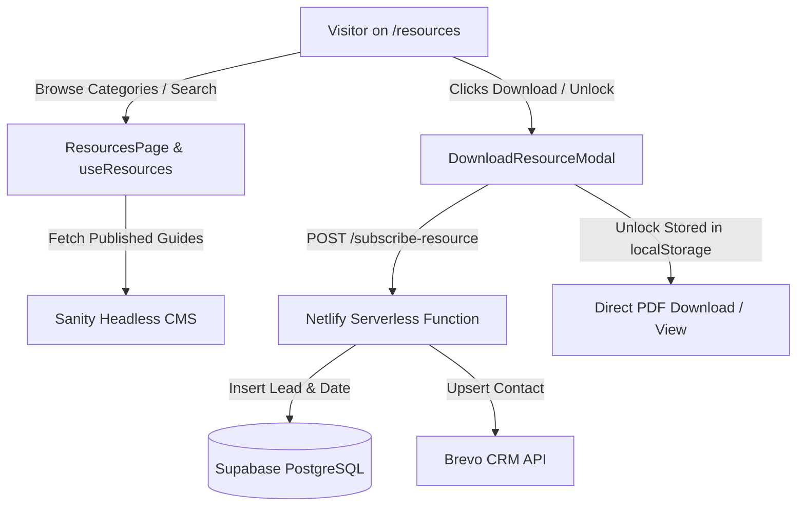

# Requirements

### Overview & Goals
Unlock Her Tech is expanding its content offering and platform infrastructure in two key areas:
1. **Supabase Data & Timestamp Capture:** Integrate Supabase (PostgreSQL) to reliably capture and persist user leads, resource download records, booking dates/timestamps, and event discount claims. This provides structured analytics and lead tracking while maintaining strict secret hygiene (`CWE-312`/`CWE-798`).
2. **Multi-Category Resources Hub Expansion:** Evolve the Resources page (`/resources`) from its initial 10-guide Career Transition Toolkit into an extensive, multi-category library of technical playbooks, system design cheatsheets, AI guides, salary negotiation workbooks, and leadership frameworks.

---

### Scope

#### In Scope
- **Supabase Integration:**
  - Serverless persistence handlers in `netlify/functions/` (`subscribe-resource.ts`, `claim-discount.ts`, and booking capture) using `@supabase/supabase-js`.
  - Database schema definitions for `resource_leads`, `booking_leads`, and `discount_claims` with timestamp tracking (`created_at`, `download_date`).
  - Graceful degradation: Network or database timeouts must never block visitors from receiving their promised PDF downloads.
- **Resources Page Multi-Category Expansion:**
  - Expanded category taxonomy in `sanity/schemas/resource.ts`, `src/app/types.ts`, and `resourceData.ts`.
  - Upgraded UI filtering and track navigation in `ResourceCategoryFilter.tsx`, `ResourceTrackSwitcher.tsx`, and `ResourcesPage.tsx`.
  - Progressive disclosure and anti-scroll-fatigue layout (`PAGE_SIZE = 9` with "Load More") adhering to repository quality guidelines.
  - Enhanced `ResourceCard.tsx` supporting category badges, format pills (Playbooks, Cheatsheets, Workbooks, Templates), target audience level, and direct download unlock triggers.

#### Out of Scope
- Migrating historical blog posts or job listings out of Sanity into Supabase (Sanity remains the headless CMS for editorial content).
- Requiring paid subscriptions or payment gateway integrations for PDF downloads (all resources remain free community assets).

---

### User Stories
- **As a non-tech career pivoter or engineer**, I want to browse resources by specialized technical categories (e.g., AI, System Design, Frontend, Leadership) and formats (Cheatsheets, Workbooks) so that I can quickly find guides relevant to my career stage.
- **As a community member**, I want to unlock and download downloadable PDF guides by entering my email once and having immediate access across all categories.
- **As an admin / platform operator**, I want all lead captures and download dates stored in Supabase with structured metadata (resource slug, category, role interest, UTM parameters) so that we have actionable data for community growth and outreach.

---

### Functional Requirements

#### 1. Supabase Lead & Timestamp Capture
- All resource unlock submissions from `DownloadResourceModal.tsx` must dispatch to `/.netlify/functions/subscribe-resource`.
- The serverless handler must insert a new record into the Supabase `resource_leads` table containing:
  - `email` (string, lowercase trimmed)
  - `full_name` (string)
  - `discord_handle` (optional string)
  - `role_interest` (string)
  - `resource_id` / `resource_slug` / `resource_title` (string)
  - `category` & `collection` (string)
  - `download_date` / `created_at` (ISO 8601 UTC timestamp)
  - `user_agent` & `referrer` (optional client context)
- Serverless calls must dual-write to Supabase and Brevo CRM (if configured), logging structured errors on failure without breaking client responses.

#### 2. Multi-Category Resources Taxonomy
- Supported Resource Collections:
  1. `career-toolkit`: 10-Guide Career Transition Roadmap (Stages 1–4)
  2. `tech-guides`: Engineering & Architecture (System Design, Frontend, Backend, Cloud)
  3. `ai-data`: AI Engineering, LLM Prompting & Data Systems
  4. `job-search`: Resume Optimization, Interview Mastery & Salary Negotiation
  5. `leadership`: Tech Lead Frameworks, Mentorship & Workplace Culture
  6. `templates`: Cheatsheets, Worksheets & Planning Templates
- Supported Resource Formats:
  - `guide`: Comprehensive PDF Playbook / Guide
  - `cheatsheet`: Quick-Reference Cheatsheet / Checklist
  - `workbook`: Interactive Worksheet / Action Planner
  - `template`: ATS Resume / Architecture Template

#### 3. Responsive Filtering & Progressive Disclosure
- Category tabs must support one-click filtering, dynamic item counts, and clear-all triggers.
- Multi-category views must render up to 9 cards initially with a "Load More" affordance to prevent scroll fatigue.
- Search input must perform real-time, debounced filtering across titles, descriptions, categories, and tags.

---

### Non-Functional Requirements
- **Security & Secret Hygiene (`CWE-312`/`CWE-798`):** `SUPABASE_SERVICE_ROLE_KEY` must never be bundled into client-side Vite builds; database writes must execute exclusively in Netlify Functions.
- **Accessibility & SonarQube Compliance:** All buttons must have explicit `type="button"`, modals must use native `<dialog open ...>`, and inputs must pair with explicit `<label htmlFor="...">`.
- **Performance:** Client-side category filtering must execute in under 16ms (60 FPS) with memoized computations (`useMemo`).

# Technical Design

### Current Implementation
- **Lead Capture:** `DownloadResourceModal.tsx` submits via `POST` to Netlify Forms (`form-name="resources-lead-magnet"`) and `/.netlify/functions/subscribe-resource.ts` which forwards to Brevo API v3 (`api.brevo.com/v3/contacts`).
- **Resource Management:** `sanity/schemas/resource.ts` defines the Sanity document schema. `src/app/utils/sanity.ts` (`getAllResources`) queries Sanity using GROQ.
- **Resources UI:** `src/app/pages/ResourcesPage.tsx` currently divides guides into Career Toolkit Stages (1 to 4) and a flat secondary grid for non-toolkit guides.

---

### Key Decisions
1. **Server-Side Supabase Client in Netlify Functions:** Use `@supabase/supabase-js` inside `netlify/functions/` initialized with `SUPABASE_URL` and `SUPABASE_SERVICE_ROLE_KEY`. This keeps write tokens off the client bundle and allows direct insertion into PostgreSQL with automatic timestamp generation.
2. **Dual-Write Architecture with Graceful Degradation:** The serverless function will write to both Supabase and Brevo in parallel (`Promise.allSettled`). Even if Supabase is unreachable or unconfigured in local preview, the function returns a 200 HTTP response so users receive their PDF download.
3. **Unified Sanity Schema with Extended Metadata:** Retain Sanity Studio at `/admin` as the content authoring tool for PDF uploads and descriptions, expanding its schema fields (`category`, `collection`, `format`, `targetLevel`, `tags`) to support all new technical tracks.
4. **Anti-Scroll-Fatigue Progressive Disclosure:** Implement tabbed track switching and chunked card rendering (`PAGE_SIZE = 9` with "Load More" button) as required by repository standards.

---

### Proposed Changes

#### 1. Backend / Serverless Layer
- **`netlify/functions/lib/supabaseClient.ts`:** Centralized helper initializing the Supabase client using environment variables.
- **`netlify/functions/subscribe-resource.ts`:** Enhanced to accept `resourceCategory`, `resourceSlug`, and `collection`, inserting records into `resource_leads`.
- **Database Schema Migration:** Define the SQL table definition with Row Level Security (RLS) enabled.

#### 2. CMS & Data Contracts
- **`sanity/schemas/resource.ts`:** Add new category and collection choices, target experience level, and tags array.
- **`src/app/types.ts`:** Update `Resource` interface with `collection`, `format`, `targetLevel`, `tags`, and `downloadCount`.
- **`src/app/pages/resources/resourceData.ts`:** Update `RESOURCE_COLLECTIONS`, `RESOURCE_CATEGORIES`, and `RESOURCE_FORMATS`.
- **`src/app/utils/sanity.ts`:** Update `getAllResources` GROQ query to project the new schema fields.

#### 3. Frontend Components & UI
- **`src/app/pages/resources/useResources.ts`:** Add pagination state (`visibleCount`), active format filters, and multi-field keyword search.
- **`src/app/pages/resources/ResourceCategoryFilter.tsx`:** Modernized filter bar with category pills, format toggles, and live search.
- **`src/app/pages/resources/ResourceTrackSwitcher.tsx`:** Updated track chips displaying live document counts per collection.
- **`src/app/pages/resources/ResourceCard.tsx`:** Enhanced card design displaying category badges, format icons, page counts, and direct download triggers.
- **`src/app/pages/ResourcesPage.tsx`:** Cohesive grid rendering with progressive disclosure, empty state illustrations, and scroll-to-top helpers.
- **`src/app/components/DownloadResourceModal.tsx`:** Forward complete resource metadata (category, collection, slug) to the serverless function.

---

### Data Models / Contracts

#### Supabase Database Schema (`resource_leads` Table)
```sql
CREATE TABLE IF NOT EXISTS public.resource_leads (
  id UUID PRIMARY KEY DEFAULT gen_random_uuid(),
  email TEXT NOT NULL,
  full_name TEXT,
  discord_handle TEXT,
  role_interest TEXT,
  resource_title TEXT NOT NULL,
  resource_slug TEXT,
  category TEXT,
  collection TEXT,
  download_date TIMESTAMPTZ NOT NULL DEFAULT NOW(),
  created_at TIMESTAMPTZ NOT NULL DEFAULT NOW()
);

-- Enable RLS and restrict direct public writes (writes occur via Netlify Function service role)
ALTER TABLE public.resource_leads ENABLE ROW LEVEL SECURITY;
```

#### TypeScript Resource Contract (`src/app/types.ts`)
```ts
export type ResourceFormat = "guide" | "cheatsheet" | "workbook" | "template";
export type ResourceTargetLevel = "All Levels" | "Beginner" | "Intermediate" | "Advanced";

export interface Resource {
  id: string;
  title: string;
  slug: string;
  description: string;
  category: string;
  collection?: string;
  format?: ResourceFormat;
  targetLevel?: ResourceTargetLevel;
  tags?: string[];
  stage?: string;
  isFeatured?: boolean;
  pdfUrl?: string;
  fileSize?: string;
  pageCount?: string;
  accentColor?: string;
  isPublished: boolean;
  publishedAt?: string;
  weekNumber?: number;
  requiresLogin?: boolean;
}
```

---

### File Structure
```text
netlify/
└── functions/
    ├── lib/
    │   └── supabaseClient.ts          # [NEW] Serverless Supabase client factory
    └── subscribe-resource.ts          # [MODIFIED] Dual-write to Brevo and Supabase

sanity/
└── schemas/
    └── resource.ts                    # [MODIFIED] Expanded categories & format fields

src/
├── app/
│   ├── components/
│   │   └── DownloadResourceModal.tsx  # [MODIFIED] Include category & collection in payload
│   ├── pages/
│   │   ├── resources/
│   │   │   ├── ResourceCard.tsx       # [MODIFIED] Badge, format & level display
│   │   │   ├── ResourceCategoryFilter.tsx # [MODIFIED] Dynamic category & format pills
│   │   │   ├── ResourceTrackSwitcher.tsx  # [MODIFIED] Collection chips with counts
│   │   │   ├── resourceData.ts        # [MODIFIED] Taxonomy constants & type definitions
│   │   │   └── useResources.ts        # [MODIFIED] Multi-category search & pagination
│   │   └── ResourcesPage.tsx          # [MODIFIED] Progressive disclosure & catalog grid
│   ├── types.ts                       # [MODIFIED] Extended Resource interface
│   └── utils/
│       └── sanity.ts                  # [MODIFIED] Updated GROQ projection query
└── test/
    └── ResourcesPage.test.tsx         # [MODIFIED] Test multi-category filtering
```

---

### Architecture Diagram


---

### Risks & Mitigations
- **Missing Supabase Environment Variables:** If `SUPABASE_URL` or `SUPABASE_SERVICE_ROLE_KEY` are not set in a staging or preview environment, `supabaseClient.ts` will log a warning and return `null`, allowing lead capture to fall back gracefully without blocking user downloads.
- **Large DOM Render / Scroll Fatigue:** With dozens of PDFs across multiple categories, rendering all cards simultaneously degrades performance. Mitigated by chunked pagination (`PAGE_SIZE = 9`) with an interactive "Load More" trigger.

# Testing

### Validation Approach
Verification will be conducted using automated Vitest unit/integration tests, TypeScript compiler verification (`tsc -b`), ESLint rule enforcement, and production build validation.

---

### Key Scenarios

1. **Category & Track Filtering:**
   - Navigating between collections (e.g. "All Resources" -> "Technical & Engineering" -> "Templates & Cheatsheets") updates the displayed card catalog and active counts.
   - Selecting a category pill (e.g. "AI & Machine Learning") filters out non-matching resources.
   - Searching for keywords (e.g. "System Design", "Salary") matches across title, description, category, and tags.

2. **Lead Capture & Supabase Persistence:**
   - Submitting the download modal triggers `POST /.netlify/functions/subscribe-resource` with full payload (`email`, `fullName`, `resourceTitle`, `category`, `collection`).
   - The serverless handler inserts a row into Supabase with valid `created_at` / `download_date` timestamps.
   - The modal updates `localStorage` (`uht_user_email`, `uht_community_member`) and reveals the direct download link.

3. **Graceful Fallback on Network Error:**
   - When Supabase or Brevo API endpoints simulate a network timeout (500/504), the serverless function handles the error cleanly, logs context, and allows the frontend to complete the unlock flow.

---

### Edge Cases
- **Empty Search Results:** Searching for a non-existent keyword displays a clean empty state with a "Reset all filters" button.
- **Already Unlocked Community Member:** Users who previously entered their email bypass the modal and download additional PDFs directly with 1 click.
- **Missing Resource Assets:** Resources with external URLs (`externalPdfUrl`) vs uploaded Sanity files (`pdfFile`) resolve correctly via `pdfUrl` coalesce.

---

### Test Changes
- Update `src/test/ResourcesPage.test.tsx` to assert multi-category filtering, collection switcher interactions, format filtering, and search query matching.
- Add test coverage for `subscribe-resource` payload structure and Supabase client error handling.

# Delivery Steps

### ✓ Step 1: Setup Supabase client and serverless data capture pipeline
Set up Supabase integration layer and serverless data capture pipeline with graceful degradation.

- Create `netlify/functions/lib/supabaseClient.ts` to initialize an authenticated server-side Supabase client using `SUPABASE_URL` and `SUPABASE_SERVICE_ROLE_KEY`.
- Define PostgreSQL schema and RLS policies for `resource_leads`, `booking_leads`, and `event_discount_claims` tables with UTC timestamps (`created_at`).
- Update `netlify/functions/subscribe-resource.ts` to persist lead submissions to Supabase while maintaining existing Brevo CRM synchronization.
- Implement robust error handling and fallback logging (`console.warn`) so database connectivity issues never block user downloads.

### ✓ Step 2: Expand Sanity resource schema and data contracts
Enhance Sanity CMS schema, frontend data types, and static category definitions to support a multi-domain PDF library.

- Update `sanity/schemas/resource.ts` with expanded categories (AI & Cloud, System Design, Frontend/Backend, Leadership, Interview Mastery), target experience levels, and tag arrays.
- Extend `Resource` and `ExtendedResource` interfaces in `src/app/types.ts` and `src/app/pages/resources/resourceData.ts`.
- Update Sanity fetch query in `src/app/utils/sanity.ts` (`getAllResources`) to select all new fields (`collection`, `format`, `targetLevel`, `tags`, `downloadCount`).
- Define updated collection metadata and category color mappings in `resourceData.ts`.

### ✓ Step 3: Upgrade Resources page UI and category filtering
Overhaul Resources page filtering, track switching, and card presentation with anti-scroll-fatigue architecture.

- Update `ResourceCategoryFilter.tsx` and `ResourceTrackSwitcher.tsx` to handle expanded categories, collection counts, and format pills.
- Refactor `ResourcesPage.tsx` and `useResources.ts` to support seamless filtering across collections, categories, formats, and keyword search.
- Enhance `ResourceCard.tsx` to display category tags, format indicators (Playbook, Cheatsheet, Workbook), target audience badges, and file sizes.
- Implement progressive disclosure and chunked pagination (`PAGE_SIZE = 9` with "Load More" controls) for extensive multi-category catalogs.

### ✓ Step 4: Integrate modal capture and verify end-to-end workflows
Connect lead capture modals to the new Supabase-backed pipeline and verify end-to-end functionality.

- Update `DownloadResourceModal.tsx` to pass full resource context (category, collection, slug, format) in form submissions.
- Ensure community unlock state (`uht_user_email`, `uht_community_member`) properly persists in `localStorage` across all resource categories.
- Update test suites (`ResourcesPage.test.tsx`, `subscribe-resource` tests) to verify category filtering, lead submission payloads, and error resiliency.
- Run `npm run typecheck`, `npm run lint`, `npm run test`, and `npm run build` to ensure clean compilation and 100% test pass rate.